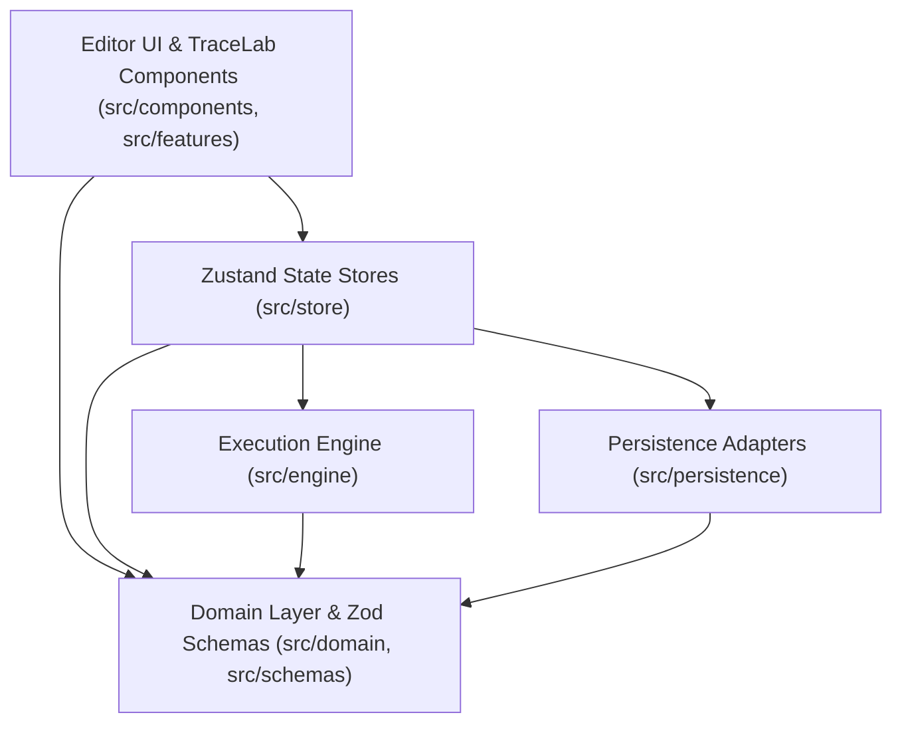

# FlowForge — Technical Architecture

**Document version:** 1.0  
**Status:** Active Specification  
**Design System:** Precision Studio (`DESIGN.md`)  
**Product Requirements:** `PRD.md`

---

## 1. System Overview

FlowForge is a local-first visual programming and workflow automation platform with an explainable execution debugger (**TraceLab**) and integrated **Testing Lab**.

A core architectural invariant of FlowForge is **strict separation between the visual editor and the execution runtime**:
- The **Domain Layer** (`src/domain/`, `src/schemas/`) defines pure TypeScript types, Zod schemas, port compatibility rules, and static graph validation algorithms without importing React or DOM APIs.
- The **Execution Engine** (`src/engine/`) evaluates validated workflows against structured inputs using a deterministic handler registry and scheduler, emitting strongly typed `ExecutionEvent` records without importing React, Zustand, or UI components.
- The **Persistence Layer** (`src/persistence/`) serializes, validates, and stores workflow documents, revisions, test suites, and execution traces in IndexedDB behind a clean adapter interface.
- The **Editor UI & TraceLab** (`src/components/`, `src/features/`, `src/store/`) renders the workflow graph, dispatches domain commands, and visualizes live or replayed execution traces.

---

## 2. Module Boundaries & Dependency Rules



### Dependency Constraints
1. `src/domain/**` and `src/schemas/**` MUST NOT import from `react`, `@xyflow/react`, `zustand`, `src/components/**`, `src/store/**`, or `src/engine/**`.
2. `src/engine/**` MUST NOT import from `react`, `@xyflow/react`, `zustand`, or `src/components/**`. It depends only on `src/domain/**`, `src/schemas/**`, and standard Web/JS APIs (`AbortSignal`, `performance.now`).
3. `src/persistence/**` depends only on `idb`, `src/domain/**`, and `src/schemas/**`.
4. `src/components/**` and `src/features/**` consume state and actions through `src/store/**` and pure helpers in `src/domain/**`.

---

## 3. Directory Structure

```text
flowforge/
├── docs/
│   ├── PRD.md
│   ├── DESIGN.md
│   ├── ARCHITECTURE.md
│   ├── WORKFLOW-FORMAT.md
│   ├── EXECUTION-SEMANTICS.md
│   └── TEST-PLAN.md
├── src/
│   ├── app/                  # Application root and workspace shell integration
│   ├── components/
│   │   ├── ui/               # Reusable Precision Studio primitives (Button, Input, Select, StatusBadge, ConfirmDialog, ToastRegion, EmptyState, PayloadViewer)
│   │   ├── shell/            # AppShell, TopBar, NavigationSidebar, BottomDrawer
│   │   ├── canvas/           # WorkflowCanvas, CanvasControls
│   │   ├── nodes/            # Custom WorkflowNode renderers
│   │   ├── edges/            # Custom ConnectionEdge renderers
│   │   └── panels/           # NodeLibrary, NodeInspector, RunInspector, ExecutionTimeline
│   ├── domain/
│   │   ├── types/            # Core TypeScript types (Workflow, Node, Edge, Port, Trace, Test, Revision)
│   │   ├── registry/         # Node type definitions, port specs, and default configurations
│   │   ├── fixtures/         # Verified sample workflows (Expense Approval, etc.)
│   │   ├── graph/            # Graph indexing, reachability, cycle detection, port compatibility
│   │   ├── validation/       # Static workflow linter and issue generator
│   │   └── versioning/       # Immutable revision records and structural diff engine
│   ├── engine/
│   │   ├── executor.ts       # Top-level workflow execution entry point
│   │   ├── scheduler.ts      # Graph traversal, branching, step controller, pause/resume
│   │   ├── context.ts        # ExecutionContext and safe operand/path resolution
│   │   ├── trace.ts          # ExecutionEvent emitter and trace recorder
│   │   └── handlers/         # Pure handlers for Trigger, Condition, Action, Transform, End, etc.
│   ├── features/
│   │   ├── templates/        # Starter templates and custom template manager
│   │   ├── trace-lab/        # Trace replay, step-through, and run comparison
│   │   ├── testing-lab/      # Test case runner, assertions, and branch coverage calculator
│   │   └── versions/         # Revision history and diff viewer
│   ├── persistence/
│   │   ├── indexeddb/        # IndexedDB database schema and stores
│   │   └── adapters/         # PersistenceAdapter interface and LocalIndexedDBAdapter
│   ├── store/                # Zustand stores for workflow, editor UI, execution, and toasts
│   ├── schemas/              # Zod schemas for workflow documents, node configs, imports, and tests
│   ├── styles/               # Precision Studio tokens.scss and global reset/utilities
│   ├── utils/                # ID generation, formatting, and deep equality helpers
│   └── tests/                # Test setup, unit tests, component tests, integration tests
├── package.json
└── vite.config.ts
```

---

## 4. Security & Reliability Boundaries

- **No Arbitrary Code Execution:** Never invoke `eval()`, `new Function()`, or dynamic script injection. Condition operators and Transform operations are evaluated strictly through a closed, type-checked handler table.
- **Untrusted Import Validation:** Imported JSON documents are checked for byte size limits (max 2 MB), node count limits (max 500 nodes), edge count limits (max 1,000 edges), format identifier (`"flowforge.workflow"`), format version (`1`), and strict Zod node configuration schemas before preview or storage. Imported workflows are never automatically executed.
- **Bounded Execution:** The runtime enforces a configurable maximum step budget (default `500` steps), loop iteration limits, and `AbortSignal` cancellation to prevent infinite loops or runaway runs.
